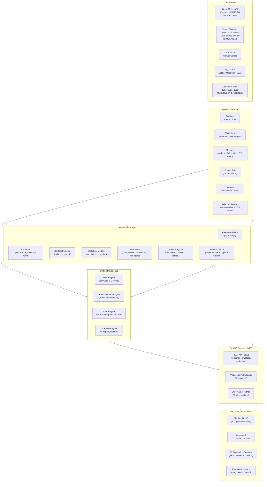

# UrbanIQ — Architecture Reference

## System Overview

UrbanIQ is an AI-driven Digital Twin platform for Coimbatore, Tamil Nadu, India. It ingests
multi-domain urban data, applies machine learning forecasting models, and renders a unified
map-based interface for city planners, analysts, and administrators.

## Component Architecture



## Data Flow

```
External Sources / MQTT Topics
    ↓
Adapters (per-source fetch/parse)
    ↓
Raw Landing Table (raw_records)
    ↓
Validation (schema, types, units, ranges)
    ↓  → Rejected Table (rejected_records + reason codes)
Cleaning (dedupe, UTC normalisation, IQR outlier flag)
    ↓
Spatial Join (→ road_segment_id, ward_id, zone_id, station_id)
    ↓
Domain Tables (traffic_observations, energy_observations, air_observations, weather_observations)
    ↓
Feature Building (time features, lags, rolling stats — no future leakage)
    ↓
Model Training (XGBoost / Statistical — time-ordered split, baseline comparison)
    ↓
Model Registry (candidate → evaluate → promote if beats baseline → active)
    ↓
Batch Forecasts (forecasts table: value + lower_bound + upper_bound + top_drivers)
    ↓
Unified Risk Engine (per-ward component table: traffic/air/energy/population 0-3)
    ↓
REST API + WebSocket
    ↓
Digital Twin (Mapbox 2D + CesiumJS 3D, synchronised via Zustand)
    ↓
Dashboards, Scenarios, Assistant, Reports
```

## Database Schema Summary

All 30 core entities defined in `backend/app/db/models.py`. Key relationships:

- `zones` → `wards` → `road_segments` (geographic hierarchy)
- `stations` → `air_observations` / `weather_observations`
- `road_segments` → `traffic_observations`
- `zones` → `energy_observations`
- `data_sources` → `ingest_runs` → `raw_records` / `rejected_records`
- `model_versions` → `training_runs`, `evaluation_results`, `forecasts`
- `wards` → `risk_snapshots`
- `scenarios` → `scenario_runs` → `scenario_results`
- `alert_rules` → `alerts` → `alert_events`
- `users` → `assistant_sessions` → `assistant_messages`
- `audit_logs` (cross-cutting)

All tables use SRID 4326 for geometry. Time-series tables are indexed by (entity_id, timestamp).

## Canonical ID System

One set of IDs used across all modules, DB, API, map, and reports:

| Entity | ID Format | Example |
|---|---|---|
| Road Segment | `RD_{ROAD}_{SEQ}` | `RD_AVINASHI_01` |
| Junction | `JCT_{NAME}` | `JCT_GANDHIPURAM_FLYOVER` |
| Ward | `WARD_{NUMBER}` | `WARD_042` |
| Zone | `ZONE_{NAME}` | `ZONE_CENTRAL` |
| Station | `STN_{NAME}_{TYPE}` | `STN_GANDHIPURAM_AQI` |
| Data Source | `SRC_{NAME}` | `SRC_OPEN_METEO_WEATHER` |

## Security Architecture

- JWT access tokens (15-min default dev TTL, 24h for demo usability) + refresh tokens (7 days)
- Passwords hashed with bcrypt (12 rounds)
- RBAC enforced as FastAPI dependencies on every route — not just button hiding
- Permission matrix defined in `security/roles.py`: 6 roles × 20 permissions
- All state-changing actions audited in `audit_logs` with actor, timestamp, before/after
- Secrets loaded from environment only — never in client bundle or logs

## Unified Risk Score

Composite score = (traffic_level + air_level + energy_level + population_level) / 4.0

Where each component level is 0=Normal, 1=Watch, 2=High, 3=Critical based on:
- **Traffic**: speed ratio vs free-flow (BPR-defined thresholds: <0.4=Critical, <0.6=High, <0.8=Watch)
- **Air**: CPCB AQI category (>300=Critical, >200=High, >100=Watch)
- **Energy**: capacity headroom % (requires capacity_reference; <10%=Critical, <15%=High, <25%=Watch)
- **Population**: 2011 Census density as a reference proxy (density >15k/km²=High)

Weights are equal by default (0.25 each). Exposed in Settings for authorised configuration.
The composite score is NEVER shown without its components table.

## Scenario Engine

For traffic: BPR speed-flow relationship — v = v_f / (1 + α × (V/C)^β)
- α = 0.25 for primary roads, 0.20 for trunk roads
- β = 3.5 (standard BPR)
- Volume perturbation applied as multiplier from scenario input
- Stated as a planning approximation, not a simulation

For energy: demand multiplier applied to baseline + temperature sensitivity curve
For air: effect shown only where traffic-air relationship is statistically supported; otherwise "effect not reliably estimable"
For population: alternative growth rate applied to census-fitted model

## Technology Stack

| Layer | Technology | Version |
|---|---|---|
| Backend | FastAPI + Pydantic v2 + SQLAlchemy 2 | 0.162 / 2.14 / 2.x |
| Database | SQLite (dev) / PostgreSQL+PostGIS (prod) | — |
| ML | XGBoost + scikit-learn | 3.x / 1.9 |
| Frontend | React 18 + Vite 5 + Tailwind CSS 3 | — |
| Maps | Mapbox GL JS + CesiumJS | 3.7 / 1.121 |
| State | Zustand 5 + TanStack Query 5 | — |
| Auth | PyJWT + bcrypt | — |
| Real-time | WebSockets (FastAPI) + Paho MQTT | — |
| Reports | ReportLab (PDF) | — |

